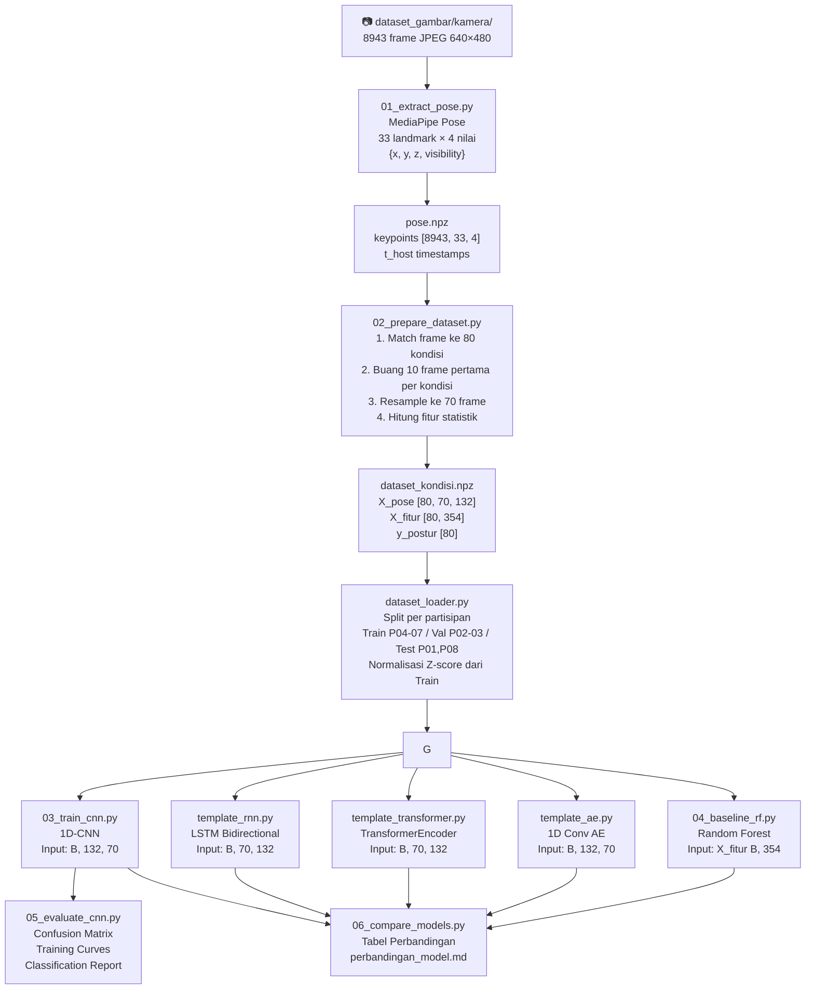

# Tim 05 – Penilaian Postur Duduk dari Citra Kamera

> **Capstone Deep Learning** · Pembimbing: Ahmad Luky Ramdani  
> Sprint 1 | Semester Ganjil 2026/2027

---

## Daftar Isi

1. [Ringkasan Proyek](#1-ringkasan-proyek)
2. [Spesifikasi Eksperimen](#2-spesifikasi-eksperimen)
3. [Struktur Folder](#3-struktur-folder)
4. [Pipeline End-to-End](#4-pipeline-end-to-end)
5. [Cara Menjalankan (Step-by-Step)](#5-cara-menjalankan-step-by-step)
6. [Panduan Kolaborasi Git untuk Anggota Tim](#6-panduan-kolaborasi-git-untuk-anggota-tim)
7. [Format Output Wajib untuk Semua Jalur](#7-format-output-wajib-untuk-semua-jalur)
8. [Arsitektur 1D-CNN (Jalur CNN)](#8-arsitektur-1d-cnn-jalur-cnn)
9. [Interpretasi Metrik](#9-interpretasi-metrik)
10. [Catatan Teknis Penting](#10-catatan-teknis-penting)

---

## 1. Ringkasan Proyek

**Masalah:** Orang yang bekerja di depan komputer sering duduk dengan postur buruk tanpa disadari, yang bisa menyebabkan masalah muskuloskeletal. Proyek ini membangun sistem pendeteksi postur duduk otomatis dari kamera webcam menggunakan deep learning.

**Pendekatan:**
- Ekstraksi 33 titik keypoint pose tubuh per frame menggunakan **MediaPipe Pose**
- Klasifikasi **5 kelas postur duduk** menggunakan model deep learning berbasis sekuens
- Perbandingan 4 arsitektur deep learning + 1 baseline non-DL

**5 Kelas Postur:**
| Label | Deskripsi |
|-------|-----------|
| `tegak` | Duduk tegak dengan punggung lurus |
| `membungkuk` | Tubuh condong ke depan/membungkuk |
| `bersandar` | Bersandar ke belakang |
| `condong ke kiri` | Tubuh condong ke sisi kiri |
| `condong ke kanan` | Tubuh condong ke sisi kanan |

**Metrik Utama:** F1-Score Macro (merata semua kelas, robust terhadap imbalance)

---

## 2. Spesifikasi Eksperimen

### Dataset

| Item | Nilai |
|------|-------|
| Jumlah partisipan | 8 (P01–P08) |
| Kondisi per partisipan | 10 |
| Total kondisi | **80 kondisi** |
| Durasi tiap kondisi | 8 detik |
| Frame per kondisi (teoritis) | ~80 frame @ ~10 FPS |
| Frame dibuang (1 detik pertama) | 10 frame (fase transisi) |
| **Frame valid per kondisi** | **70 frame** |
| Resolusi kamera | 640×480 piksel |
| Interval capture | ~100ms (10 FPS) |

### Alasan Pembuangan 1 Detik Pertama

Setiap kondisi diawali dengan **fase transisi** di mana partisipan masih berpindah dari postur sebelumnya ke postur target. Frame-frame ini tidak merepresentasikan postur yang ingin diklasifikasi, sehingga **10 frame pertama (1 detik) WAJIB dibuang** dari setiap kondisi. Ini meningkatkan kualitas data latih secara signifikan.

### Desain Eksperimen

```
Blok 1: P01 (10 kondisi × 8 detik) → 80 frame → buang 10 → 70 frame valid/kondisi
Blok 2: P02 (10 kondisi)
...
Blok 8: P08 (10 kondisi)
---
Total frame diproses: ~8943 frame kamera
Total data setelah segmentasi: 80 kondisi × 70 frame = 5600 frame valid
```

### Split Data (Subject-Independent)

> ⚠️ **WAJIB diikuti semua anggota tim.** Partisipan TIDAK boleh terbagi antara train dan test.

| Split | Partisipan | Jumlah Kondisi (pasca k+2) |
|-------|-----------|----------------------------|
| **Train** | P04, P05, P06, P07 | 32 kondisi |
| **Val** | P02, P03 | 16 kondisi |
| **Test** | P01, P08 | 16 kondisi |

**Mengapa subject-independent?** Model harus mampu mengenali postur **orang yang belum pernah dilihat** selama pelatihan. Jika frame dari satu partisipan masuk ke train dan test sekaligus, skor akan sangat tinggi secara artifisial karena model "menghafal" penampilan orang tersebut.

---

## 3. Struktur Folder

```
t05-postur-duduk-s1/
│
├── README.md                        ← Dokumentasi utama (file ini)
├── requirements.txt                 ← Dependensi Python
├── .gitignore                       ← Mengecualikan data mentah, model .pt, gambar
│
├── dataset_gambar/                  ← [TIDAK masuk Git] Data mentah kamera
│   ├── kamera/                      ← 8943 frame JPEG (f000001.jpg – f008943.jpg)
│   ├── kamera_index.csv             ← {berkas, t_host} timestamp tiap frame
│   ├── jam.csv                      ← Kalibrasi jam laptop vs komputer meja
│   └── peristiwa.csv                ← Event log sesi rekaman
│
├── data_label/                      ← [TIDAK masuk Git] Label sesi eksperimen
│   └── sesi-20261117-143626/
│       ├── label.csv                ← 80 kondisi: partisipan, postur, timestamp
│       └── rula.csv                 ← [OPSIONAL] Skor RULA dari 2 penilai
│
├── data/processed/                  ← Hasil preprocessing (di-generate oleh skrip)
│   ├── pose.npz                     ← Keypoints MediaPipe semua frame [N, 33, 4]
│   ├── dataset_kondisi.npz          ← Dataset tersegmentasi [80, 70, 132]
│   ├── label_bersih.csv             ← 80 kondisi bersih dengan info frame
│   └── split_indices.npz            ← Indeks train/val/test (reproducible)
│
├── src/                             ← Semua kode sumber
│   ├── 01_extract_pose.py           ← Ekstraksi MediaPipe Pose → pose.npz
│   ├── 02_prepare_dataset.py        ← Segmentasi kondisi, buang 1s, rekayasa fitur
│   ├── dataset_loader.py            ← Modul bersama: get_dataloaders(), get_numpy_splits()
│   ├── _03_cnn_model.py             ← Definisi arsitektur CNN1D (dapat diimport)
│   ├── 03_train_cnn.py              ← [CNN] Training 1D-CNN
│   ├── 04_baseline_rf.py            ← [Non-DL] Random Forest baseline
│   ├── 05_evaluate_cnn.py           ← Evaluasi lengkap + visualisasi
│   ├── 06_compare_models.py         ← Tabel perbandingan 4 jalur + RF
│   ├── template_rnn.py              ← [TEMPLATE] untuk anggota RNN
│   ├── template_transformer.py      ← [TEMPLATE] untuk anggota Transformer
│   └── template_ae.py               ← [TEMPLATE] untuk anggota Autoencoder
│
├── results/
│   ├── cnn/                         ← Hasil jalur CNN
│   │   ├── metrics.json
│   │   ├── tambahan.json
│   │   ├── training_history.json
│   │   ├── best_cnn.pt              ← [TIDAK masuk Git] Bobot model
│   │   ├── training_curves.png
│   │   ├── confusion_matrix.png
│   │   └── classification_report.txt
│   ├── rnn/                         ← [TO-DO] Anggota RNN mengisi ini
│   ├── transformer/                 ← [TO-DO] Anggota Transformer mengisi ini
│   ├── ae/                          ← [TO-DO] Anggota AE mengisi ini
│   ├── random_forest/               ← Hasil baseline Random Forest
│   ├── perbandingan_model.md
│   ├── perbandingan_model.csv
│   └── perbandingan_model.png
│
└── sprint-1/                        ← Kode starter dari dosen (JANGAN DIUBAH)
    ├── src/
    │   ├── common/                  ← Starter: split beku, evaluator, manifest
    │   └── protokol/                ← Starter: loader data piksel Sprint 1
    └── results/
        ├── contoh-cnn/              ← Contoh output CNN dari Sprint 1
        └── non-dl/                  ← Contoh output non-DL dari Sprint 1
```

---

## 4. Pipeline End-to-End



### Tahap 1: Ekstraksi Pose (01_extract_pose.py)

**MediaPipe Pose** mengekstrak 33 landmark tubuh dari setiap frame:

```
Landmark per frame: 33 titik × 4 nilai = 132 nilai
  - x, y     : posisi ternormalisasi [0, 1] relatif lebar/tinggi gambar
  - z        : kedalaman relatif (estimasi)
  - visibility: kepercayaan deteksi [0, 1]
```

Frame yang gagal terdeteksi (pose tidak terlihat): keypoints diisi `0.0`, flag `deteksi_ok=False`. Strategi ini memastikan **tidak ada NaN** di array output.

### Tahap 2: Segmentasi, Penyelarasan `k+2`, & Rekayasa Fitur (02_prepare_dataset.py)

Sesuai temuan pada `sprint-1/src/protokol/PROTOKOL.md`, partisipan berganti postur **setelah** melihat isyarat kartu web yang menyorot kondisi yang sudah selesai, sehingga postur untuk label kondisi `k` baru terlihat pada jendela rekaman kondisi **`k+2`** (~17–25 detik setelah kondisi `k` dimulai, di dalam blok partisipan yang sama).

- **Penyelarasan `k → k+2`:** Label kondisi `k` dipasangkan dengan rentang waktu `[t_mulai_host, t_selesai_host]` milik kondisi `k+2` pada partisipan dan blok yang sama. Dua kondisi terakhir setiap partisipan tidak memiliki pasangan `k+2` dalam bloknya sehingga dibuang (16 dari 80 kondisi dibuang → **64 kondisi valid**).
- **Pembuangan 1 detik pertama:** Dari rekaman kondisi `k+2` (~80 frame @ 10 FPS), **10 frame pertama (1 detik)** dibuang sebagai fase transisi, lalu di-resample/padding tepat menjadi **70 frame valid** per kondisi (`X_pose` shape: `[64, 70, 132]`).

```
Label kondisi k ──(geser k+2 dalam blok)──► Rekaman kondisi k+2: t_mulai → t_selesai (8 detik, ~80 frame)
                                            ├── Buang 10 frame pertama (1 detik transisi)
                                            └── Ambil 70 frame valid   (7 detik postur stabil)
```

**Fitur statistik untuk baseline RF:**

| Grup Fitur | Detail | Jumlah |
|-----------|--------|--------|
| Sudut sendi | 6 sendi × {mean, std, min, max} | 24 |
| Kecepatan pose | 33 landmark × {mean, std, max} | 99 |
| Statistik posisi | 33 landmark × {x,y} × {mean, std} | 132 |
| **Total** | | **255+ fitur** |

**Sudut sendi yang dihitung:**
- Siku kiri/kanan (shoulder→elbow→wrist)
- Bahu kiri/kanan (hip→shoulder→elbow)
- Pinggul kiri/kanan (shoulder→hip→knee)

### Tahap 3: Pembagian Data (dataset_loader.py)

```python
# Format input untuk masing-masing model:
# 1D-CNN     : (Batch, 132, 70)  → Channels, Time
# RNN / TRF  : (Batch, 70, 132)  → Time, Features
# RF (sklearn): (N, 354)          → Flattened features
```

---

## 5. Cara Menjalankan (Step-by-Step)

### Prasyarat

```bash
# 1. Clone repo
git clone <URL_REPO>
cd t05-postur-duduk-s1

# 2. Install dependensi
pip install -r requirements.txt

# 3. Pastikan data mentah sudah ada:
#    dataset_gambar/kamera/ (8943 frame JPEG)
#    data_label/sesi-20261117-143626/label.csv
```

### Urutan Eksekusi

```bash
# Tahap 1: Ekstraksi 33 keypoint MediaPipe dari semua frame
python src/01_extract_pose.py
# Output: data/processed/pose.npz (~8943 frame, 33 landmarks)
# Estimasi waktu: 10–30 menit tergantung CPU

# Tahap 2: Segmentasi kondisi + rekayasa fitur
python src/02_prepare_dataset.py
# Output: data/processed/dataset_kondisi.npz, label_bersih.csv
# Waktu: < 1 menit

# Verifikasi split (opsional tapi direkomendasikan)
python src/dataset_loader.py

# Tahap 3: Latih 1D-CNN (jalur saya)
python src/03_train_cnn.py --epoch 50 --seed 1
# Output: results/cnn/ (metrics.json, best_cnn.pt, training_history.json)
# Waktu: 5–20 menit CPU

# Tahap 3b: Baseline Random Forest
python src/04_baseline_rf.py --seed 1
# Output: results/random_forest/ (metrics.json, tambahan.json)
# Waktu: < 1 menit

# Tahap 4: Evaluasi + visualisasi CNN
python src/05_evaluate_cnn.py
# Output: results/cnn/ (confusion_matrix.png, training_curves.png, classification_report.txt)

# Tahap 5: Perbandingan semua model (setelah semua anggota selesai)
python src/06_compare_models.py
# Output: results/perbandingan_model.md / .csv / .png
```

---

## 6. Panduan Kolaborasi Git untuk Anggota Tim

### Setup Awal

```bash
# Clone repo (pertama kali)
git clone <URL_REPO>
cd t05-postur-duduk-s1
pip install -r requirements.txt

# Download data mentah (dari link yang dibagikan Penjaga Data)
# Letakkan di: dataset_gambar/kamera/ dan data_label/sesi-20261117-143626/
```

### Workflow per Anggota Tim

```bash
# Buat branch sendiri SEBELUM mulai coding
git checkout -b jalur-rnn      # atau jalur-transformer / jalur-ae

# Pastikan data processed sudah ada (dari anggota yang sudah extract)
# Jika belum ada: jalankan 01 dan 02 dulu, atau minta file dari rekan

# Jalankan model Anda (GUNAKAN template sebagai titik awal)
cp src/template_rnn.py src/train_rnn.py     # untuk RNN
# Edit src/train_rnn.py → implementasikan training loop lengkap
python src/train_rnn.py --seed 1

# Commit hasil
git add results/rnn/metrics.json results/rnn/tambahan.json
git add src/train_rnn.py
git commit -m "feat(rnn): tambah model LSTM bidirectional, val_f1=0.XX"
git push origin jalur-rnn

# Buat Pull Request ke main
```

### Cara Memuat Data (WAJIB diikuti semua jalur)

```python
from src.dataset_loader import get_dataloaders, get_numpy_splits

# --- Untuk model PyTorch (CNN, AE) ---
# format_cnn=True → tensor (B, 132, 70) = (Batch, Channels, Time)
dl_train, dl_val, dl_test, info = get_dataloaders(
    batch_size=32,
    format_cnn=True,   # True untuk CNN/AE, False untuk RNN/Transformer
)
print(f"Train: {info.n_train} | Val: {info.n_val} | Test: {info.n_test}")

# --- Untuk model RNN / Transformer ---
# format_cnn=False → tensor (B, 70, 132) = (Batch, Time, Features)
dl_train, dl_val, dl_test, info = get_dataloaders(
    batch_size=32,
    format_cnn=False,  # ← UBAH INI untuk RNN/Transformer
)

# --- Untuk sklearn (Random Forest, SVM, dll.) ---
X_train, y_train, X_val, y_val, X_test, y_test = get_numpy_splits(
    mode="fitur",     # "fitur" untuk sklearn, "pose" untuk PyTorch
)
print(f"X_train shape: {X_train.shape}")  # (40, 354)
```

> ⚠️ **PENTING:** Gunakan selalu `get_dataloaders()` atau `get_numpy_splits()` dari `dataset_loader.py`. Jangan buat split manual sendiri — ini menjamin semua jalur menggunakan test set yang identik.

---

## 7. Format Output Wajib untuk Semua Jalur

Setiap anggota tim **WAJIB** menyimpan hasil dalam format berikut agar `06_compare_models.py` dapat menggabungkannya:

### `results/<jalur>/metrics.json`

```json
{
  "metrik": {
    "val_acc": 0.750000,
    "val_macro_f1": 0.772040,
    "test_acc": 0.700000,
    "test_macro_f1": 0.750000
  },
  "seed": 1,
  "perangkat": "cpu laptop",
  "model": "rnn-lstm",
  "n_val": 20,
  "n_test": 20,
  "durasi_detik": 120.5
}
```

### `results/<jalur>/tambahan.json`

```json
{
  "jalur": "rnn",
  "seed": 1,
  "hiper": {
    "epoch": 50,
    "lr": 0.001,
    "batch": 32,
    "hidden": 128
  },
  "parameter": 350000,
  "epoch_terbaik": 25,
  "val_f1_makro": 0.772,
  "val_f1_rinci": {
    "tegak": 0.70,
    "membungkuk": 0.85,
    "bersandar": 0.75,
    "condong ke kiri": 0.80,
    "condong ke kanan": 0.78
  },
  "test_f1_makro": 0.75,
  "test_f1_rinci": { "...": "..." },
  "riwayat": [
    {"epoch": 1, "loss": 1.35, "val_f1": 0.20, "val_acc": 0.25},
    "..."
  ]
}
```

---

## 8. Arsitektur 1D-CNN (Jalur CNN)

```
Input: (Batch, 132, 70)
  │                        ← 132 channels = 33 landmark × 4 nilai
  │                           70 time steps = 70 frame valid per kondisi
  ▼
Block 1: Conv1d(132→128, k=5) → BN → ReLU → MaxPool(2) → Dropout(0.3)
  Output: (B, 128, 35)
  ▼
Block 2: Conv1d(128→256, k=5) → BN → ReLU → MaxPool(2) → Dropout(0.3)
  Output: (B, 256, 17)
  ▼
Block 3: Conv1d(256→256, k=3) → BN → ReLU → Dropout(0.3)
  Output: (B, 256, 17)
  ▼
AdaptiveAvgPool1d(1) → squeeze
  Output: (B, 256)
  ▼
┌─────────────────────┐    ┌──────────────────────┐
│ Kepala Klasifikasi  │    │ Kepala Regresi RULA   │
│ Linear(256→128)     │    │ (opsional, jika       │
│ ReLU                │    │  rula.csv tersedia)   │
│ Dropout(0.3)        │    │ Linear(256→64)        │
│ Linear(128→5)       │    │ ReLU                  │
│                     │    │ Linear(64→1)           │
└──────────┬──────────┘    └──────────┬────────────┘
           │                           │
      Logits (B,5)             Skor RULA (B,1)
      5 kelas postur           MAE loss
```

**Hyperparameter default:**
- Learning rate: 1e-3 (AdamW + Cosine Annealing)
- Batch size: 32
- Max epochs: 50 + early stopping (patience=15)
- Weight decay: 1e-4
- Dropout: 0.3
- Class weights: inversely proportional to class frequency

---

## 9. Interpretasi Metrik

### F1-Score Macro

$$F1_{macro} = \frac{1}{5} \sum_{c=1}^{5} \frac{2 \cdot TP_c}{2 \cdot TP_c + FP_c + FN_c}$$

- Merata F1 dari **5 kelas secara setara**, tidak terpengaruh dominasi kelas besar
- **Target**: F1-Macro ≥ 0.80 pada test set
- Interpretasi: 0.0 = random, 1.0 = sempurna

### MAE Skor RULA (jika rula.csv tersedia)

$$MAE = \frac{1}{N} \sum_{i=1}^{N} |y_i - \hat{y}_i|$$

- Skor RULA berkisar 1–7 (skor ergonomi risiko cedera)
- MAE < 1.0 dianggap baik untuk prediksi skor ergonomi

### Confusion Matrix

Baris = **kelas aktual**, Kolom = **prediksi model**:
- Diagonal = prediksi benar
- Off-diagonal = kesalahan klasifikasi
- Pola kesalahan umum: `condong ke kiri` ↔ `condong ke kanan` jika pencahayaan tidak simetris

---

## 10. Catatan Teknis Penting

### Tentang Waktu di Dataset

Semua timestamp (`t_host`) menggunakan **jam komputer meja** (epoch seconds). File `rekam-web.json` mencatat selisih jam laptop–server (±32ms) yang sudah dikoreksi. Karena itu `kamera_index.csv` dan `label.csv` dapat langsung dicocokkan tanpa koreksi tambahan.

### Tentang MediaPipe Pose

- Digunakan dalam mode **`static_image_mode=True`** (bukan video) karena frame diproses satu per satu sesuai indeks
- `model_complexity=1` (default): keseimbangan akurasi vs kecepatan
- Landmark 0–10: wajah | 11–22: tubuh atas | 23–32: tubuh bawah
- Landmark paling relevan untuk postur: 11, 12 (bahu), 23, 24 (pinggul), 13, 14 (siku)

### Tentang Frame Gagal Deteksi

Jika MediaPipe tidak mendeteksi pose (frame buram, orang keluar frame, dll.):
1. Keypoints diisi `0.0` (tidak dihapus)
2. Flag `deteksi_ok=False`
3. Saat segmentasi kondisi: frame gagal di-forward-fill dari frame sebelumnya

### Tantangan Dataset ini

- **Sedikit data**: hanya 80 kondisi → regularisasi dan augmentasi penting
- **Subject-independent split yang ketat**: model HARUS general ke orang baru
- **Ketidakseimbangan minor**: distribusi kelas tidak sempurna merata
- **Variasi intra-partisipan**: 1 partisipan = 2 ulangan per postur → mirip satu sama lain

### Kondisi dengan Frame di Bawah Target (Diketahui dari Audit)

9 dari 80 kondisi memiliki kurang dari 70 frame yang terdeteksi di `kamera_index.csv`. Ini terjadi karena kondisi ini adalah kondisi **pertama tiap blok partisipan** — kamera belum sepenuhnya berjalan saat blok dimulai. `02_prepare_dataset.py` menangani ini dengan **padding frame terakhir** hingga 70 frame.

| No | Partisipan | Postur | Frame Tersedia | Strategi |
|----|-----------|--------|---------------|----------|
| 1  | P01 | membungkuk | 57 | Pad +13 frame |
| 11 | P02 | bersandar  | 44 | Pad +26 frame |
| 21 | P03 | membungkuk | 25 | Pad +45 frame |
| 31 | P06 | bersandar  | 54 | Pad +16 frame |
| 46 | P05 | bersandar  | 13 | Pad +57 frame ⚠ |

> ⚠ Kondisi no.46 (P05/bersandar, hanya 13 frame) perlu diperhatikan — labelnya mungkin kurang reliable. Pertimbangkan untuk menandainya dalam evaluasi.

---

*Dibuat otomatis oleh pipeline Tim 05 | Update terakhir: November 2026*
